<!-- Local typing animation (assets/typing.svg). No third-party service involved. If it ever fails to render, delete this block. -->

  

  

---

## About Me

I work where AI meets software engineering. My focus is turning models into dependable features: ML and LLM components exposed through REST APIs, wrapped in backend workflows with structured validation, and connected to real applications. I want the model to do what it is good at while everything that must be correct stays deterministic and testable.

<table>
  <tr><td><b>Name</b></td><td>Amir M. Ibrahim</td></tr>
  <tr><td><b>Current role</b></td><td>Backend AI Engineer Intern at FlyRank AI (since June 2025)</td></tr>
  <tr><td><b>University</b></td><td>B.Sc. Software Engineering, Assiut National University (expected June 2027, GPA 3.7/4.0)</td></tr>
  <tr><td><b>Main technical focus</b></td><td>Python and FastAPI backends, ML model integration over REST, computer vision (YOLOv8)</td></tr>
  <tr><td><b>Current learning direction</b></td><td>Generative AI and reliable LLM-powered workflows (CIB Summer Program, GenAI track)</td></tr>
</table>

## Tech Stack

Everything below comes from my CV.

**AI and Machine Learning** 

**Backend Engineering** 

**Mobile and Integration** 

**Data and Infrastructure** 

## Featured Projects

<table>
  <tr><td>
    <h3><a href="https://github.com/dfhhgh/ai-fitness-agent">AI Fitness Agent</a></h3>
    
<b>Problem:</b> LLM-driven fitness advice is hard to trust when the numbers behind it are generated rather than calculated.

    
<b>Engineering:</b> I designed an architecture where the LLM handles conversation, profile extraction and candidate meal suggestions, while profile validation, conflict handling, nutrition calculations and state transitions stay deterministic. The workflow runs from onboarding and missing-field resolution to nutrition targets, food selection and workout-plan generation, with JSON Schema validation of the resulting plans. I also documented which nutrition-planning context is exposed to the planner, to the user, and to internal audit data.

    
<b>Status:</b> The architecture and workflow design are documented in the CV; see the repository for what is currently implemented.

    
    
    
  </td></tr>
</table>

<table>
  <tr><td>
    <h3>EYRA (repository currently private)</h3>
    
<b>Problem:</b> Visually impaired users need a quick way to know about nearby people and obstacles.

    
<b>Engineering:</b> I built a Flutter mobile app that uses the device camera and sends frames to a YOLOv8 computer vision service over REST, turning detections into audio alerts. I deployed the inference service on Render and configured the production endpoint the app talks to.

    
<b>Status:</b> Implemented as described in the CV. Code is available on request.

    
    
    
    
  </td></tr>
</table>

<table>
  <tr><td>
    <h3><a href="https://github.com/dfhhgh/tariqi">Tariqi</a></h3>
    
<b>Problem:</b> Road damage is slow to find by hand; images can be screened automatically instead.

    
<b>Engineering:</b> I built YOLOv8 road-damage detection models in Python and integrated the inference service with a backend API and a Flutter mobile client, connecting the model, backend and application layers.

    
<b>Status:</b> Implemented as described in the CV.

    
    
    
    
  </td></tr>
</table>

<table>
  <tr><td>
    <h3><a href="https://github.com/dfhhgh/SmartIDPhotoProcessor">Smart ID Photo Processor</a></h3>
    
<b>Problem:</b> ID photos must meet framing and quality rules, and checking them manually does not scale.

    
<b>Engineering:</b> I designed a modular, object-oriented Python architecture and built a multi-stage computer vision pipeline for face detection, alignment, cropping and image-quality checks. Each stage is an independently testable component.

    
<b>Status:</b> Implemented as described in the CV.

    
    
    
  </td></tr>
</table>

<table>
  <tr><td>
    <h3><a href="https://github.com/dfhhgh/customer-churn-revenue-retention">Customer Churn Prediction and Revenue Retention</a></h3>
    
<b>Problem:</b> Telecom companies need to identify customers likely to leave so retention effort can be targeted.

    
<b>Engineering:</b> I built an end-to-end Python/XGBoost pipeline on a dataset of more than 100,000 customers, covering feature engineering, predictive modeling and evaluation. The reported ROC-AUC is 0.699, a modest result on a hard problem, and a baseline to improve on.

    
<b>Status:</b> Implemented as described in the CV.

    
    
    
  </td></tr>
</table>

## GitHub Activity

> Third-party services: the cards below are generated by GitHub Readme Stats and GitHub Streak Stats, the follower badge by shields.io and the view counter by komarev.com. GitHub itself does not calculate these numbers. Any of them may be slow or briefly unavailable.

<a href="https://github.com/dfhhgh">
  <picture>
    <source media="(prefers-color-scheme: dark)" srcset="https://github-readme-stats.vercel.app/api?username=dfhhgh&show_icons=true&hide_border=true&theme=tokyonight&count_private=true&hide=stars" />
    <source media="(prefers-color-scheme: light)" srcset="https://github-readme-stats.vercel.app/api?username=dfhhgh&show_icons=true&hide_border=true&theme=default&count_private=true&hide=stars" />
    
  </picture>
  <picture>
    <source media="(prefers-color-scheme: dark)" srcset="https://github-readme-stats.vercel.app/api/top-langs/?username=dfhhgh&layout=compact&hide_border=true&theme=tokyonight&langs_count=6" />
    <source media="(prefers-color-scheme: light)" srcset="https://github-readme-stats.vercel.app/api/top-langs/?username=dfhhgh&layout=compact&hide_border=true&theme=default&langs_count=6" />
    
  </picture>
</a>

<a href="https://github.com/dfhhgh">
  <picture>
    <source media="(prefers-color-scheme: dark)" srcset="https://streak-stats.demolab.com?user=dfhhgh&hide_border=true&theme=tokyonight" />
    <source media="(prefers-color-scheme: light)" srcset="https://streak-stats.demolab.com?user=dfhhgh&hide_border=true&theme=default" />
    
  </picture>
</a>

<!--
  OPTIONAL 1: contribution snake (self-hosted by a GitHub Action in this repo).
  Enable only after the "Generate contribution snake" workflow has run successfully
  and the "output" branch contains github-snake.svg and github-snake-dark.svg.
  Then remove this comment wrapper.

<picture>
  <source media="(prefers-color-scheme: dark)" srcset="https://raw.githubusercontent.com/dfhhgh/dfhhgh/output/github-snake-dark.svg" />
  <source media="(prefers-color-scheme: light)" srcset="https://raw.githubusercontent.com/dfhhgh/dfhhgh/output/github-snake.svg" />
  
</picture>
-->

<!--
  OPTIONAL 2: contribution activity graph (third-party: github-readme-activity-graph).
  This service is hosted on a free tier and is often unavailable, and I could not test it,
  so it is off by default. To try it, remove this comment wrapper and check it renders.

-->

## Experience and Certifications

**Backend AI Engineer Intern, FlyRank AI** (June 2025 to present)

- Developing AI-powered backend services in Python with FastAPI
- Integrating machine learning models into backend systems through REST APIs
- Building data-processing pipelines for automated AI application workflows
- Completed practical assignments and a capstone project that was reviewed and accepted

**GenAI Summer Program, Commercial International Bank (CIB)** (August 2026)

- Selected for the 2026 Generative AI track, covering GenAI, digital banking and emerging technologies

**Certifications**

- [AWS Certified Machine Learning Engineer – Associate](https://cp.certmetrics.com/amazon/en/public/verify/credential/f386d9364fa74b42a53fc014d099edfc) (October 2026)
- [AWS Certified AI Practitioner (AIF-C01)](https://cp.certmetrics.com/amazon/en/public/verify/credential/6619a27f313d45af99ae19001b568edf) (July 2026 to July 2029)
- [OCI 2025 Certified AI Foundations Associate](https://catalog-education.oracle.com/ords/certview/sharebadge?id=B769447AD641459667528CB11B1F4D9A00522A2DAA322885810C26AA8C16211D) (Oracle)
- Neural Networks and Deep Learning (DeepLearning.AI, Coursera)

## Connect With Me

- LinkedIn: [amir-m-ibrahim](https://www.linkedin.com/in/amir-m-ibrahim-76245631a)
- Portfolio: [dfhhgh.github.io/amir-portfolio](https://dfhhgh.github.io/amir-portfolio/)
- Codeforces: [OmranAmir](https://codeforces.com/profile/OmranAmir)

Open to internship opportunities in backend and AI engineering.
